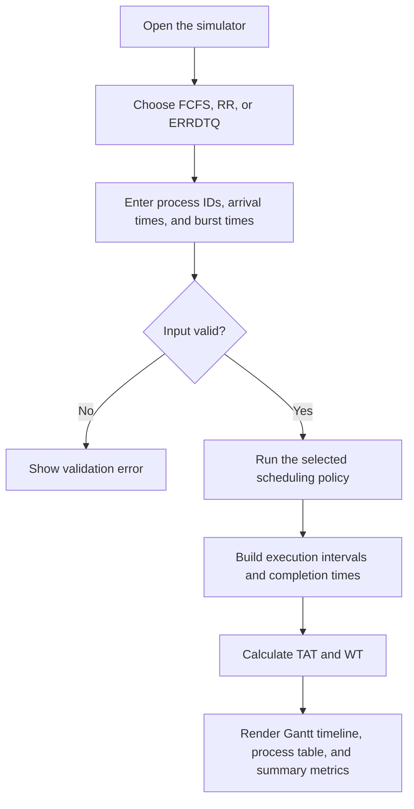

# CPU Process Scheduling Simulator

A small browser-based simulator for comparing three CPU scheduling policies: First-Come, First-Served (FCFS), Round Robin (RR), and an educational implementation named **ERRDTQ** (Enhanced Round Robin with Dynamic Time Quantum).

The project is a single HTML page with its CSS and JavaScript included. It does not need Node.js, a package manager, a database, or a build step.

## What it does

- Accepts up to 20 processes with a process ID, arrival time, and CPU burst time.
- Runs FCFS, fixed-quantum Round Robin, or the ERRDTQ demonstration.
- Displays execution intervals as a Gantt-style timeline.
- Reports completion time (CT), turnaround time (TAT), and waiting time (WT) for each process.
- Calculates average waiting time, average turnaround time, CPU utilization, and throughput.
- Includes a sample cloud-task workload for the dynamic-quantum demonstration.

## Run it

The quickest option is to open `index.html` in a current desktop browser. No installation is required.

For a local HTTP server, open a terminal in the project directory and run:

```bash
python -m http.server 8000
```

On Windows, this may be available as:

```powershell
py -m http.server 8000
```

Then visit <http://localhost:8000>. Stop the server with `Ctrl+C`.

See [SETUP.md](SETUP.md) for the steps and a quick check that the simulator is running.

## Enter process data

Use one process per line in the format `ID,arrival time,burst time`:

```text
P1,0,5
P2,1,3
P3,2,8
P4,3,6
```

Commas or spaces can separate the three fields. Process IDs must be unique. Arrival time must be a non-negative whole number; burst time must be a positive whole number. The page accepts 1–20 process rows.

Choose an algorithm and select **Run Simulation**. For Round Robin, also enter a positive whole-number time quantum. **Reset Example** restores the default data and FCFS selection.

## Scheduling flow



## Metrics used

For process \(i\), the simulator uses these definitions:

$$
TAT_i = CT_i - AT_i
$$

$$
WT_i = TAT_i - BT_i
$$

where \(AT\) is arrival time, \(BT\) is burst time, and \(CT\) is completion time.

For \(n\) processes:

$$
\overline{WT} = \frac{1}{n}\sum_{i=1}^{n} WT_i
\qquad
\overline{TAT} = \frac{1}{n}\sum_{i=1}^{n} TAT_i
$$

The current implementation calculates CPU utilization and throughput as:

$$
\text{CPU Utilization} = \frac{\sum_{i=1}^{n} BT_i}{T_{end}}\times100\%
\qquad
\text{Throughput} = \frac{n}{T_{end}}
$$

Here, \(T_{end}\) is the final simulation time, measured from time zero. As a result, idle time before the first process arrives is included in the utilization interval. Throughput is expressed as completed processes per simulation time unit.

## Algorithms and interpretation

- **FCFS:** runs jobs in arrival order and does not preempt a running job.
- **Round Robin:** runs a ready process for up to the selected fixed time quantum, then requeues it if it has remaining burst time.
- **ERRDTQ demonstration:** orders ready processes by remaining burst time, recalculates a quantum using the rounded 80th-percentile position, and checks the one-third-quantum preemption condition when new work arrives. The implementation details are documented in [docs/algorithm-notes.md](docs/algorithm-notes.md).

**Research-source note:** the supplied HTML describes ERRDTQ as based on a paper, but it does not contain the paper's full citation or a link to the paper. The simulator therefore documents the rules implemented in the supplied page; it does not claim that those rules have been independently verified against the original publication. Add the exact title, authors, venue, year, and URL/DOI from the Stage 1 source before submitting this as a paper reproduction.

## Project files

```text
cpu-scheduling-simulator/
├── index.html
├── README.md
├── SETUP.md
└── docs/
    └── algorithm-notes.md
```

## Scope and limitations

This is a teaching aid, not a kernel scheduler. It assumes CPU burst times are known and does not model I/O blocking, process priorities, context-switch overhead, multicore CPUs, or operating-system scheduling APIs. Results are generated in the browser and are not saved to a database.
